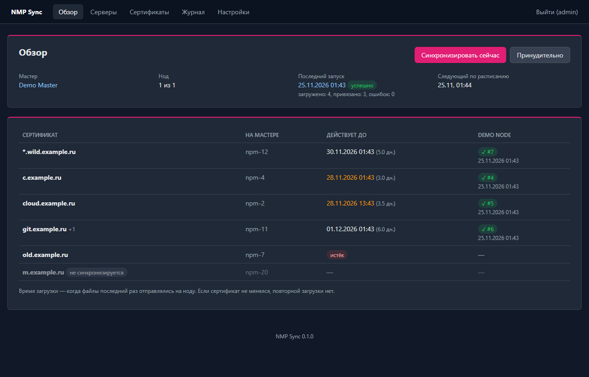
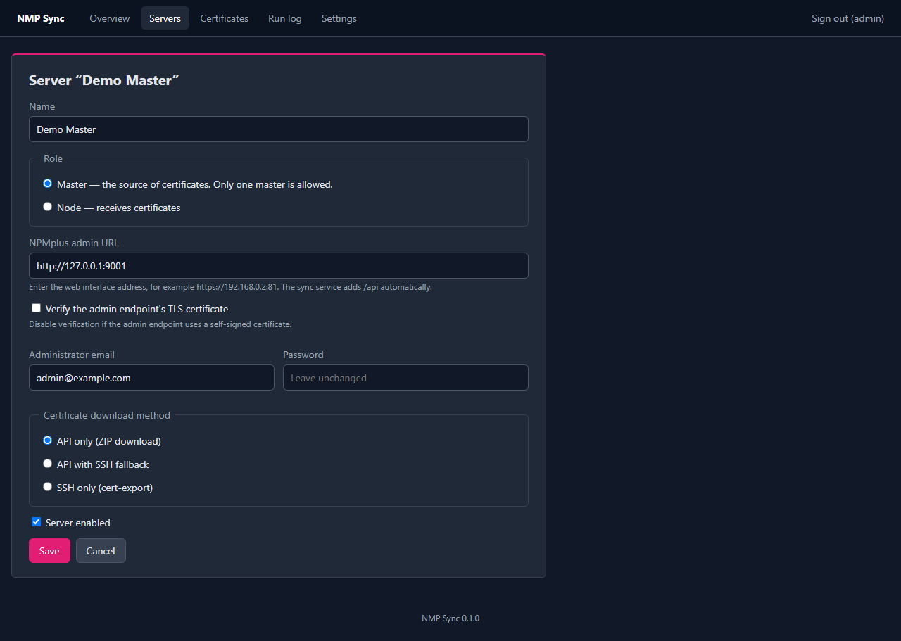
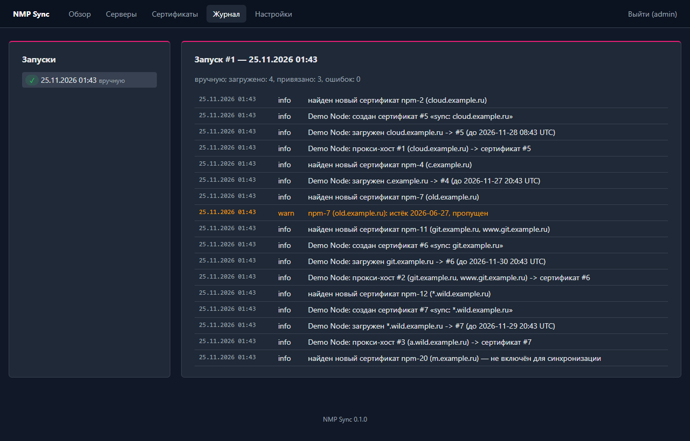
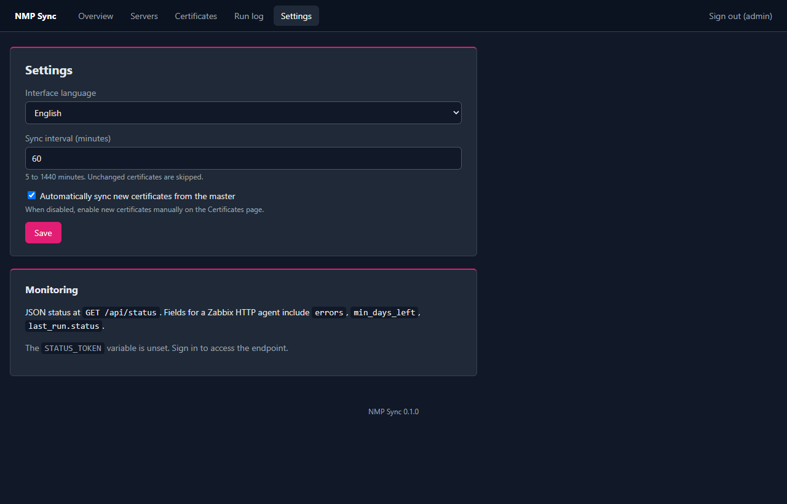

# NPMplus TLS Sync

NPMplus TLS Sync is a Docker service with a web interface for distributing TLS
certificates between NPMplus or Nginx Proxy Manager instances. One instance is
the **master**, where Certbot obtains and renews certificates. The other
instances are **nodes**, which receive them as custom certificates named
`sync: <domain>`.

> **Contains AI-generated content.** The source code, documentation, and other
> text in this repository may contain content generated by an AI model at the
> request and under the direction of the maintainer.

## Features

- Configure server roles, API credentials, and TLS verification from the web interface.
- Download certificates from the master through the NPMplus admin API, over
  SSH, or through the admin API with SSH as a fallback.
- Choose which certificates to sync. New certificates are enabled automatically
  by default, except for custom certificates discovered through the API.
  Expired certificates are skipped.
- Verify that the private key matches the certificate. Use a SHA-256
  fingerprint of the certificate chain and key to skip unchanged uploads.
- Reuse existing custom certificates named `sync: <domain>`, including those
  created by the legacy `certsync` script.
- Optionally assign certificates to proxy hosts on each node. Every domain on
  a proxy host must be covered, including wildcard matches.
- Run on a schedule (5–1440 minutes), sync on demand, or force a re-upload.
  Review the results in the run log or through the monitoring endpoint.

## NPMplus compatibility

The reference version is
[NPMplus 2026-11-18-r1](https://github.com/ZoeyVid/NPMplus/releases/tag/2026-11-18-r1).
Its [certificate download and upload routes](https://github.com/ZoeyVid/NPMplus/blob/2026-11-18-r1/backend/routes/nginx/certificates.js#L228-L318)
match the endpoints used by the sync service. Automated synchronization tests
use mock NPM servers. End-to-end compatibility with this NPMplus release
still needs to be verified on a running instance. No minimum supported
version has been established.

## Screenshots

The web interface is shown below with sample servers and certificates.

### Overview



### Server configuration



### Run log



### Settings



## Quick start

1. Copy the environment template and restrict access to the copy.

   ```sh
   cp .env.example .env
   chmod 600 .env
   ```

2. Edit `.env`. Set `APP_SECRET` to a persistent random value of at least 16
   characters (generate one with `openssl rand -base64 32`). Set
   `ADMIN_PASSWORD` to a password of at least 8 characters. The default login
   name is set by `ADMIN_USER` and is `admin`.
3. Build and start the service.

   ```sh
   docker compose up -d --build
   ```

4. Open `http://<docker-host>:8090` and sign in.
5. Add the master and nodes on the **Servers** page. Enter each
   instance's admin URL, such as `https://192.168.0.2:81`, and its NPMplus
   administrator credentials. Use the same base URL you use to open the
   NPMplus web interface. The sync service adds `/api` to call the admin API.
   Keep TLS verification enabled when the endpoint has a certificate trusted
   by the container. The NPMplus README lists Swagger UI at `/swagger` on the
   same admin interface. [NPMplus documentation](https://github.com/ZoeyVid/NPMPlus#list-of-some-changes)
6. Use **Test** on each server. The master's API check tries to
   download one certificate when a non-custom certificate is available. If the
   API cannot download it, configure the SSH fallback below.
7. On the **Overview** page, click **Sync now** and check the run log.

The interface defaults to English. To switch to Russian, open **Settings**,
select **Русский** under **Interface language**, and click **Save**. The
setting applies to the installation, including the sign-in page and new
run logs. Saved run logs keep the language they were written in.

### Use a prebuilt release image

Download the `linux-amd64.tar.gz` image archive from the
[GitHub Releases page](https://github.com/aspidovss/NPMplus-tls-sync/releases).
In the repository directory, prepare `.env` as described in steps 1–2 above.
Replace `v0.1.0` below with the release tag you downloaded.

```sh
docker load --input npmplus-tls-sync-v0.1.0-linux-amd64.tar.gz
```

In `docker-compose.yml`, set the service's `image` to `nmp-sync:v0.1.0` and
start it with `docker compose up -d --no-build`. Continue with step 4 above.
The release image targets Linux on x86-64.

### Nodes on the Docker host

Inside the sync container, `127.0.0.1` refers to the container itself. To reach
a node running on the Docker host, enter `https://host.docker.internal:81`
(the Compose file already maps that hostname) or use the host's LAN address.

## SSH fallback

On the master host, install the bundled export script and create a dedicated
SSH key. Run these commands from the project directory as root.

```sh
install -m 755 scripts/cert-export /usr/local/bin/cert-export
ssh-keygen -t ed25519 -N '' -C nmp-sync -f nmp-sync
echo "restrict,command=\"/usr/local/bin/cert-export\" $(cat nmp-sync.pub)" >> /root/.ssh/authorized_keys
```

In the master's settings, choose API with SSH fallback or SSH only. Enter the
SSH connection details and paste the contents of `nmp-sync` into the private
key field. The forced command supports `list` for discovery and `npm-N` for
exporting one certificate. It expects the NPMplus container to be named
`npmplus`. Edit the default in `cert-export` if yours has a different name.
The SSH host key is recorded in `/data/known_hosts` on first connection.

## Migrating from certsync

1. Start the container, add your master and nodes, and run a manual sync.
2. Check the run log for errors. Existing matching `sync: <domain>` entries
   should be reused without a certificate creation event.
3. Once the new sync works, disable the old timer on the host that runs it.

   ```sh
   systemctl disable --now certsync.timer
   ```

## Monitoring

Set `STATUS_TOKEN` in `.env` and send it in the `X-Token` header when
requesting `GET /api/status`. An authenticated web session can also access
the endpoint.

```sh
curl --fail -H "X-Token: $STATUS_TOKEN" http://localhost:8090/api/status
```

Set the shell variable `STATUS_TOKEN` to the same value before running the
command. The response includes the latest completed run, the error count,
the shortest remaining lifetime among enabled certificates that have not
expired, and per-node status for each enabled certificate. In Zabbix, you can
alert when `errors` is greater than zero, `last_run.status` reports a failure,
or a numeric `min_days_left` falls below your threshold.

## Security and storage

- Restrict the UI to trusted clients, for example by binding the published port
  to a LAN address or restricting access through an NPMplus Access List. For
  HTTPS deployments, set `COOKIE_SECURE=1`.
- Forms use CSRF tokens. The session cookie uses `SameSite=Strict`, and
  failed login attempts incur a short delay.
- Server passwords and SSH keys are encrypted in SQLite using a key derived
  from `APP_SECRET`. Keep the same secret across restarts and when restoring
  the data volume.
- Node API accounts need permission to manage certificates and, if automatic
  assignment is enabled, proxy hosts.
- Compose stores application state in the named volume mounted at `/data`.
  The container runs as UID 10001. If you use a bind mount, make its data
  directory writable by that UID.

## Development

In a POSIX shell, start the two mock servers and the app, then run the
end-to-end checks. Use a fresh SQLite database for each run.

```sh
pip install -r requirements.txt
python -m dev.mock_npm --port 9001 --role master --auth cookie &
python -m dev.mock_npm --port 9002 --role node --auth bearer &
DB_PATH="$(mktemp -d)/nmpsync.db" APP_SECRET=dev-secret-0123456789 ADMIN_PASSWORD=adminpass1 \
  uvicorn app.main:app --port 8080 &
# Wait for the mock servers and the application to start before running the test.
python -m dev.e2e
```

The end-to-end checks cover certificate creation and reuse, unchanged
certificates, rotation, proxy-host assignment, expired certificates, and
authentication failures, and changes to a node's address or certificate
mapping. GitHub Actions builds the Docker image, checks `/health` and
`/login`, and runs the end-to-end checks against that container. For a
version tag such as `v0.1.0`, a separate job publishes the tested image to
GitHub Releases after all checks pass.

## License

MIT
